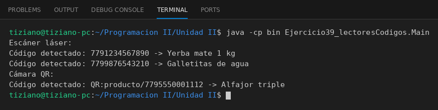

# LectorOptico

Programación II - Unidad 2 - Ejercicio 39

## Consigna
Un punto de venta lee productos con distintos lectores ópticos intercambiables.

## Lógica
- Interfaz `LectorOptico` con `String escanearCodigo()`.
- `EscanerLaser` (códigos de barras) y `CamaraQR` (códigos QR) simulan la captura.
- `PuntoVenta` mantiene una referencia al lector, permite cambiarlo y busca el producto en un catálogo.
- `Main`: dos escaneos láser y uno con cámara QR.

## Ejecución

